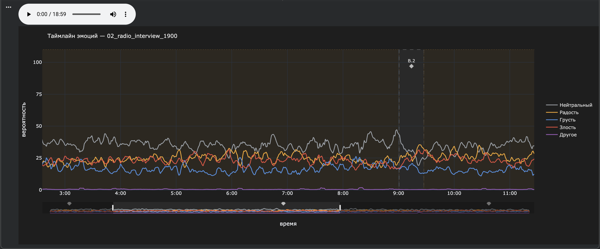
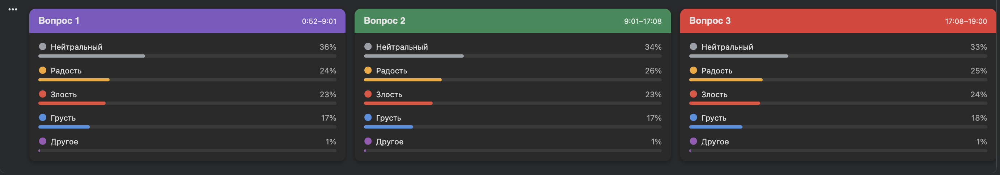

<div align="center">

# AI Deep Interview Empath

**Анализ глубинных интервью по аудиозаписи: кто говорит, что сказано, где вопросы и с какими эмоциями на них отвечают.**




</div>

Исследователь проводит часовое интервью, а потом часами переслушивает запись, чтобы найти моменты, где респондент заволновался или оживился. Пайплайн делает первый проход за него: размечает спикеров и их роли, транскрибирует речь с пословными таймингами, находит вопросы интервьюера и строит таймлайн эмоций по голосу. На выходе один JSON и две визуализации, по которым видно, на каких вопросах стоит остановиться.

## Пайплайн

```
аудио ──► 16 kHz моно ──► диаризация ──► транскрипция ──► роли ──► вопросы и ответы ──► эмоции ──► JSON + графики
                          pyannote 3.1   faster-whisper   эвристика  пунктуация +         wav2vec2 +
                                         large-v3         по 3 признакам  вопросительные слова  своя голова (Dusha)
```

| Этап | Как сделано | Почему так |
|---|---|---|
| **1. Загрузка** | Стерео сводится в моно, ресемплинг до 16 kHz | Общий формат для pyannote, Whisper и wav2vec2 |
| **2. Диаризация** | `pyannote/speaker-diarization-3.1`; соседние реплики одного спикера с паузой ≤ 2 с склеиваются | Модель рвёт монолог на куски по 0.5-2 с, без склейки текст реплики не собрать |
| **3. Транскрипция** | `faster-whisper large-v3` с пословными таймингами и VAD; слово привязывается к сегменту, в который попадает его центр | Границы сегментов подгоняются под реальные слова |
| **4. Роли** | Голосование трёх признаков: меньше суммарное время речи, короче средняя реплика, начинает первым | На интервью с двумя спикерами хватает эвристики без LLM |
| **5. Вопросы** | Реплики интервьюера режутся на предложения; вопрос – это `?` в конце или вопросительное слово среди первых трёх; уточнения подряд склеиваются в один вопрос | Whisper не всегда ставит `?`, второй канал ловит неявные вопросы |
| **6. Эмоции** | Замороженный `wav2vec2-base` + обученная линейная голова на 5 классов Dusha (`neutral / angry / positive / sad / other`), окно 2 с с шагом 1 с; окна без речи пропускаются | Голова весит 17 КБ и обучается за минуты на T4, веса лежат в репозитории |
| **7. Результат** | Pydantic-контракт `InterviewAnalysis` → JSON, таймлайн эмоций (Plotly) и карточки вопросов | Каждый этап дописывает свою секцию, этапы можно перезапускать независимо |

## Контракт данных

Все этапы пишут в один типизированный объект, поэтому результат любого этапа можно проверить отдельно:

```
InterviewAnalysis
├── audio             AudioMeta       – название, длительность, sample rate
├── speakers[]        Speaker         – S0, S1 + роль interviewer / respondent
├── segments[]        Segment         – реплика: спикер, текст, слова с таймингами и уверенностью
├── questions[]       Question        – текст вопроса, тайминги, кто задал
└── emotion_timeline[] EmotionPoint   – окно 2 с: спикер, доминирующая эмоция, вероятности 5 классов
```

## Пример работы

Радиоинтервью на 19 минут (`02_radio_interview_1900`, Colab, T4):

| Что | Результат |
|---|---|
| Спикеры | 2; интервьюер – 137.8 с речи, респондент – 985.7 с |
| Сегменты | 213 кусков диаризации → 40 реплик после склейки |
| Транскрипция | 2636 слов, язык определён как `ru` (p = 1.00) |
| Вопросы | 3 |
| Таймлайн эмоций | 1119 точек |



## Запуск

1. Откройте `ai-deep-interview-empath.ipynb` в Google Colab и включите GPU (T4).
2. Примите условия использования модели [pyannote/speaker-diarization-3.1](https://huggingface.co/pyannote/speaker-diarization-3.1) на Hugging Face и добавьте токен в Colab Secrets под именем `HF_TOKEN`.
3. Загрузите `ser_head_dusha.pt` из репозитория в `/content`: тогда голова эмоций не переобучается. Без файла ноутбук предложит обучить её заново на `nixiieee/dusha_balanced` (5000 примеров, 3 эпохи).
4. В ячейке конфига выберите `INTERVIEW_NUM` (1-3) и запустите ноутбук по порядку. Тестовые записи скачиваются с archive.org автоматически.

## Структура

```
ai-deep-interview-empath.ipynb   пайплайн целиком: от аудио до JSON и визуализаций
ser_head_dusha.pt                веса обученной головы эмоций (17 КБ)
assets/                          скриншоты визуализаций
tests/                           дополнительные записи для проверки
```

## Ограничения и что дальше

- **Точность модели эмоций пока не измерена** на отложенной части Dusha. Голова линейная и обучена на 5000 примеров за 3 эпохи, поэтому распределения получаются сглаженными: нейтральный класс держится около 35%, остальные в диапазоне 17-26%. Следующий шаг – замерить accuracy и macro-F1 и попробовать GigaAM, предобученный на русской речи, вместо `wav2vec2-base`.
- **Поиск вопросов эвристический:** правило "вопросительное слово среди первых трёх" иногда срабатывает на утверждениях. Его можно заменить LLM-классификатором реплик интервьюера.
- **Только два спикера:** роли определяются для интервью один на один.
- Эмоции сейчас считаются только по голосу; следующий шаг – объединить их с анализом текста ответов.
